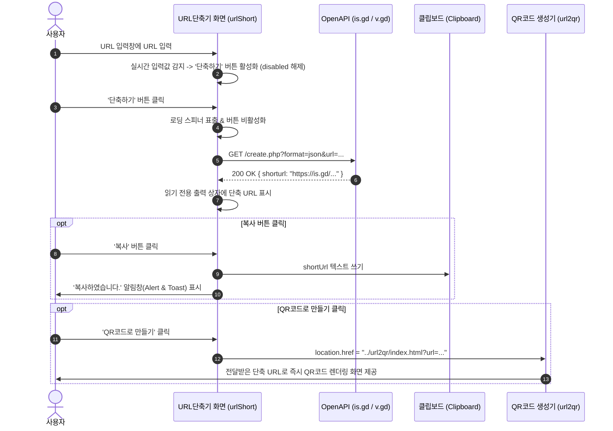

# 📋 QR & URL Toolkit 프로젝트 개요 및 기능 명세서

---

## 1. 프로젝트 개요 (Project Overview)

### 1.1 프로젝트 명칭
- **QR & URL Toolkit** (스마트 링크 & QR 올인원 플랫폼)

### 1.2 프로젝트 목적 및 배경
현대 웹 환경에서 링크(URL)는 정보 공유와 마케팅, 오프라인 연계의 핵심 매개체입니다. 본 프로젝트는 사용자에게 다음 두 가지 필수적인 링크 유틸리티를 직관적이고 감각적인 UI/UX로 통합 제공하는 것을 목적으로 합니다:
1. **QR코드 생성기 (`url2qr`)**: 입력한 웹 주소를 실시간으로 선명한 QR코드로 렌더링하고 고해상도 JPG 파일로 즉시 저장.
2. **URL 단축 서비스 (`urlShort`)**: 길고 복잡한 URL을 OpenAPI(`is.gd`, `v.gd`)를 통해 짧고 깔끔하게 단축하고, 원클릭 복사 및 QR코드 연계 생성 지원.

### 1.3 핵심 기술 스택
- **구조 (Markup)**: Semantic HTML5
- **스타일 (CSS)**: Vanilla CSS3 (Tailwind 무의존, CSS Custom Properties 기반 감성 파스텔 글래스모피즘, 반응형 모바일 지원)
- **로직 (Script)**: Vanilla JavaScript (ES6+, 비동기 `fetch` API, Clipboard API, Canvas API)
- **외부 연동**:
  - `QRCode.js`: 클라이언트 사이드 QR코드 캔버스 렌더링
  - `is.gd` & `v.gd` OpenAPI: 무료 및 무인증 초고속 단축 URL 생성 API (CORS 공개 지원)

---

## 2. 시스템 디렉토리 구조 (Directory Architecture)

```
project06/
├── index.html              # [메인 허브] QR코드 / URL단축 선택 및 빠른 이동 포털
├── css/
│   └── style.css           # 메인 허브 전용 파스텔 글래스모피즘 스타일시트
├── js/
│   └── main.js             # 마우스 인터랙션 및 3D 틸트 카드 애니메이션
├── img/
│   └── logo.png            # 공통 브랜딩 로고 에셋
│
├── url2qr/                 # [모듈 1] QR코드 생성 서비스
│   ├── index.html          # QR코드 생성기 화면 (헤더 서비스 전환 네비게이션 포함)
│   ├── css/
│   │   └── style.css       # 앰비언트 그래디언트 및 QR 스테이지 애니메이션
│   ├── js/
│   │   ├── app.js          # QR 실시간 렌더링, JPG 저장, 쿼리파라미터 연동
│   │   └── qrcode.min.js   # QR 생성 라이브러리
│   └── img/
│       └── logo.png        # 서비스 로고
│
├── urlShort/               # [모듈 2] URL 단축 서비스 (신규 구축)
│   ├── index.html          # URL 단축기 화면 (입력창, 단축버튼, 출력창, 복사버튼)
│   ├── css/
│   │   └── style.css       # 단축 폼, 결과 카드, 토스트 및 모달 알림 스타일
│   ├── js/
│   │   └── app.js          # 입력 실시간 감지, OpenAPI 연동, 클립보드 복사 & 알림
│   └── img/
│       └── logo.png        # 서비스 로고
│
├── README.md               # 프로젝트 실행 및 사용 가이드
└── SPECIFICATION.md        # 상세 기능 명세서 (본 문서)
```

---

## 3. 상세 기능 명세서 (Functional Specification)

### [기능 1] 메인 허브 화면 및 서비스 전환 (요구사항 1, 2)

| 항목 | 상세 내용 |
| :--- | :--- |
| **기능 ID** | `FN-HUB-01` |
| **화면 경로** | `/index.html` |
| **요구사항 1** | 상단 네비게이션 및 중앙 허브 카드에 **'QR코드' 버튼**과 **'URL단축' 버튼** 제공 |
| **요구사항 2** | **'QR코드' 버튼** 클릭 시 `url2qr/index.html`로 즉시 연결 |
| **요구사항 3** | **'URL단축' 버튼** 클릭 시 `urlShort/index.html`로 즉시 연결 |
| **UI/UX 특징** | - 마우스 위치 반응형 앰비언트 파스텔 젤리 오브 배경 효과<br>- 서비스 선택 카드 호버 시 부드러운 3D 원근 틸트(Perspective Tilt) 효과<br>- 모바일/태블릿 반응형 레이아웃 자동 전환 |

---

### [기능 2] QR코드 생성 서비스 (기존 `url2qr` 연계 강화)

| 항목 | 상세 내용 |
| :--- | :--- |
| **기능 ID** | `FN-QR-01` |
| **화면 경로** | `/url2qr/index.html` |
| **헤더 네비게이션** | 상단에 'QR코드(현재 활성)' 및 'URL단축' 버튼을 배치하여 페이지 간 원활한 전환 지원 |
| **입력 및 생성** | URL 입력 후 '확인' 버튼 클릭 시 중앙에 고해상도 QR코드 즉시 렌더링 |
| **JPG 다운로드** | QR코드 클릭 또는 'JPG 다운로드' 버튼 클릭 시 Canvas를 JPG 파일로 자동 변환 및 다운로드 |
| **연동 지원** | URL 파라미터 `?url=...` 수신 시 자동으로 해당 URL로 QR코드를 즉시 생성 |

---

### [기능 3] URL 단축 서비스 (요구사항 3, 3-1, 3-2, 3-3, 3-4)

| 항목 | 요구사항 매핑 | 상세 구현 사양 |
| :--- | :--- | :--- |
| **URL 입력창** | **3-1** | `<input type="text" id="urlInput">`<br>- 플레이스홀더 제공 (`https://example.com/...`)<br>- 입력 내용이 있을 때 즉시 지울 수 있는 원클릭 삭제(X) 버튼 제공<br>- 프로토콜(`https://`) 누락 시 자동 보완 |
| **단축하기 버튼** | **3-1, 3-2** | `<button id="btnShorten" disabled>`<br>- **초기 상태**: 입력 필드가 비어있으므로 비활성화(`disabled`)<br>- **실시간 감지**: `input`, `keyup` 이벤트를 통해 공백 제외 1자 이상 입력되면 활성화<br>- **텍스트 삭제 시**: 즉시 다시 비활성화 처리 |
| **OpenAPI 단축 요청** | **3-3** | '단축하기' 버튼 클릭 시 비동기 `fetch` 통신<br>- **1순위**: `is.gd` OpenAPI (`https://is.gd/create.php?format=json&url=...`)<br>- **2순위 (Fallback)**: `v.gd` OpenAPI<br>- **로딩 상태**: 버튼 내 스피너 애니메이션 및 텍스트 '단축 중...' 표시 |
| **읽기 전용 출력 상자** | **3-1, 3-3** | `<input type="text" id="shortUrlOutput" readonly>`<br>- OpenAPI 성공 응답값을 표시<br>- 사용자의 임의 수정을 방지하고 선택이 용이하도록 `readonly` 설정 |
| **복사 기능 & 알림** | **3-4** | `<button id="btnCopy">`<br>- 클릭 시 단축된 URL을 클립보드에 자동 복사 (`navigator.clipboard.writeText`)<br>- **"복사하였습니다."** 브라우저 표준 `alert` 알림창 호출<br>- 하단 슬라이드업 **토스트 알림 ("복사하였습니다.")** 동시 표출 |
| **부가 편의 기능** | 확장 | - **새 창 열기**: 단축된 URL 즉시 테스트 방문<br>- **QR코드로 만들기**: 단축된 URL을 가지고 `url2qr/index.html?url=...`로 자동 연계<br>- **최근 단축 히스토리**: LocalStorage를 이용해 최근 5개 단축 내역 보관 및 재복사 지원 |

---

## 4. OpenAPI 인터페이스 규격서

### 4.1 기본 엔드포인트: `is.gd` API
- **Endpoint**: `https://is.gd/create.php`
- **Method**: `GET`
- **CORS Support**: 지원 (`Access-Control-Allow-Origin: *`)
- **Query Parameters**:
  - `format`: `json` (응답 형식 지정)
  - `url`: `encodeURIComponent(대상URL)`
- **성공 응답 (JSON)**:
  ```json
  {
    "shorturl": "https://is.gd/SzNOOZ"
  }
  ```
- **에러 응답 (JSON)**:
  ```json
  {
    "errorcode": 1,
    "errormessage": "Please enter a valid URL to shorten"
  }
  ```

### 4.2 Fallback 엔드포인트: `v.gd` API
- **Endpoint**: `https://v.gd/create.php`
- **Method**: `GET`
- **규격**: `is.gd`와 100% 동일한 Request/Response 스펙 공유

---

## 5. 데이터 흐름 및 시퀀스 다이어그램 (Sequence Diagram)



---

## 6. 비기능적 요구사항 (Non-Functional Requirements)

1. **디자인 통일성 및 감성 품질**:
   - `url2qr`, `urlShort`, 루트 메인 페이지 모두 웜 파스텔 톤앤매너(`Warm Creamy & Honey Amber`)와 세련된 글래스모피즘(Glassmorphism) 시스템 통일 적용.
2. **반응형 웹 디자인 (Responsive Design)**:
   - 모바일(320px~), 태블릿(768px~), 데스크톱(1024px~) 전 해상도에서 레이아웃 깨짐 없이 쾌적하게 동작.
3. **웹 접근성 (Accessibility)**:
   - 모든 대화형 버튼과 입력창에 명확한 `aria-label`, `title`, `role` 속성 및 고대비 텍스트 색상 채택.
4. **견고한 예외 처리**:
   - 잘못된 도메인 형식 입력 시 에러 팁 표시.
   - 네트워크 통신 장애 시 2차 Fallback API 자동 시도.
